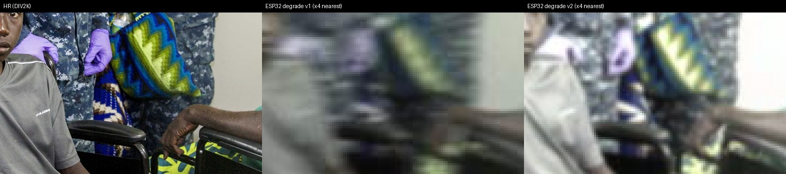

# Super-Resolution (ESPCN / EDSR + PixelShuffle)

基于 PyTorch 的图像超分辨率项目：在 DIV2K + Flickr2K 上训练 X2/X3/X4 超分模型，
并针对 ESP32 摄像头的真实退化（低照度、绿偏、软焦、噪声、JPEG）做域适配。

- **`edsr`（默认，推荐）**：残差网络 + PixelShuffle，默认 128 通道 / 32 残差块，约 **10.78M** 参数。
- **`espcn`**：3 个卷积层 + PixelShuffle，约 37K 参数；保留用于兼容旧的 res01/res02 checkpoint。
- **最终结果（X4，整图验证）**：EDSR bicubic **28.61 dB**（基线 26.94），ESP32 v2 **19.56 dB**（基线 15.90）。
  完整表格与权重说明见 [`docs/RESULTS.md`](docs/RESULTS.md)。

**哪些是共享的、哪些是作者本地的：**

| 范围 | 内容 |
|---|---|
| 共享（队友需要） | 训练/推理、ESP32 退化模型、LR 数据集生成、两个可视化服务 |
| 作者本地（不随仓库提供） | ESP32 摄像头采集链路（capture server、Android 中转、真实参考图 `data/esp32_camera/`） |

队友**不需要 ESP32 硬件**：退化模型已冻结，只要有 DIV2K/Flickr2K HR 就能生成同样的 LR（见
[`docs/DATASETS.md`](docs/DATASETS.md)）。

## 目录

- [快速开始（无数据集）](#快速开始无数据集)
- [网络结构](#网络结构)
- [数据准备](#数据准备)
- [ESP32 退化模型](#esp32-退化模型)
- [安装](#安装)
- [训练](#训练)
- [断点续训](#断点续训)
- [从已有 run 初始化](#从已有-run-初始化)
- [推理](#推理)
- [实验工具与可视化服务](#实验工具与可视化服务)
- [产物与权重](#产物与权重)
- [对齐说明](#对齐说明)
- [项目结构](#项目结构)
- [协作约定](#协作约定)

## 快速开始（无数据集）

只需要 Python + uv，不需要 DIV2K/Flickr2K 或任何权重：

```bash
uv sync
.venv/bin/python scripts/smoke_test.py
```

它会构建 ESPCN/EDSR、跑一次整图/分块推理，并做一次 checkpoint 往返，用来确认
依赖、CUDA/CPU、模型结构和推理链路都正常。输出类似：

```text
ok  espcn params=37,200 output=(1, 3, 128, 128)
ok  edsr  params=10,780,675 output=(1, 3, 128, 128)
ok  tiled inference (64, 48) -> (256, 192) on cuda
ok  self-describing checkpoint round-trip
smoke test passed
```

## 网络结构

### ESPCN

RGB 输入、放大倍数 `r`（默认 4）：

| 层 | 卷积核 | 通道 | 激活 |
|---|---|---|---|
| Conv1 | 5×5 | 3 → 64 | ReLU |
| Conv2 | 3×3 | 64 → 32 | ReLU |
| Conv3 | 3×3 | 32 → 3·r² | 无 |
| PixelShuffle(r) | — | 3·r² → 3，同时 H×r, W×r | — |

- 最后一层不接激活，输出 `3·r²` 个通道，由 `PixelShuffle` 重排为 `r×r` 的空间块，完成上采样。
- X4 时 48 通道 → 3 通道，参数量约 37K。
- 通道数可通过 `--mid1` / `--mid2` 调整。

### EDSR-lite（推荐）

特征提取全部在低分辨率空间完成，最后再上采样：

```
head  Conv3x3        3 -> C
body  N x ResidualBlock(C)          # x + 0.1 * conv2(relu(conv1(x)))
fuse  conv_after(body) + head       # 全局残差（LR 空间）
up    [Conv3x3 C -> C*4, PixelShuffle(2)] x log2(r)   # r=2/4/8
      (r=3 时改用一级 Conv3x3 C -> C*9, PixelShuffle(3))
tail  Conv3x3        C -> 3
```

- 无 BatchNorm；残差分支乘 `0.1`，避免深层堆叠时数值爆炸。
- 上采样：r=2/4/8 用多级 `PixelShuffle(2)`；r=3 用单个 `PixelShuffle(3)`。
- 默认 `C=128, N=32` → **10.78M** 参数；可用 `--channels` / `--n-blocks` 调整。
- 显存实测（RTX 5070 8GB，patch 192、batch 16）：训练峰值约 **1.2 GB**，整图验证约 1.8 GB。

### 模型对比（X4，最终结果）

| LR 类型 | bicubic 基线 | ESPCN | EDSR 128/32 |
|---|---:|---:|---:|
| `bicubic` | 26.94 dB | 27.62 dB（res02） | **28.61 dB**（res03） |
| `unknown` | 21.94 dB | 22.90 dB（res01） | **27.35 dB**（res04） |
| `esp32_v2` | 15.90 dB | — | **19.56 dB**（res08） |

验证集为 DIV2K valid + Flickr2K 5% hold-out，共 232 张，整图 PSNR。每个 run 的
epoch 数、patch/batch、初始化方式和权重获取见 [`docs/RESULTS.md`](docs/RESULTS.md)。
ESP32 的 PSNR 绝对值低是因为退化很重，不能跨 LR 类型比较，应看相对 bicubic 基线的提升。


左：bicubic ×4；中：EDSR `res03`；右：DIV2K HR。

## 数据准备

目录结构（`data/` 已被 `.gitignore` 忽略）：

```
data/
├── DIV2K/
│   ├── DIV2K_train_HR/                 # 800 张 HR (.jpeg)
│   ├── DIV2K_valid_HR/                 # 100 张 HR (.jpeg)
│   ├── DIV2K_train_LR_bicubic/X4/      # <stem>x4.png
│   ├── DIV2K_train_LR_unknown/X4/      # <stem>x4.png
│   └── DIV2K_valid_LR_*/X4/
└── Flickr2K/
    ├── Flickr2K_HR/                    # 2650 张 HR (.png)
    ├── Flickr2K_LR_bicubic/X4/         # <stem>x4.png
    └── Flickr2K_LR_unknown/X4/         # <stem>x4.png
```

> 目录中的 `X4` 随 `--scale` 变化（`X2` / `X3` / `X4`）。LR 默认按 `<HR stem>x{scale}.png`
> 匹配（例如 HR `0001.jpeg` ↔ LR `0001x4.png`，其他扩展名也可）。接入自己的数据集时
> 按同样结构放置，或修改 `train.py` 顶部的 `TRAIN_SOURCES` / `VAL_SOURCES`。

**数据不在 Git 仓库里**（DIV2K 约 4.5 GB、Flickr2K 约 22 GB、压缩包约 3.1 GB，总计约
30 GB）。完整获取、解压、校验步骤见 [`docs/DATASETS.md`](docs/DATASETS.md)。

```bash
# 下载 DIV2K 的 zip（脚本不会自动解压）
bash scripts/download_div2k.sh

# 可选：只补 LR 归档（train+valid, X2/X3/X4, bicubic+unknown）
bash scripts/download_div2k_lr.sh

# 解压示例（详细命令见 docs/DATASETS.md）
cd data/DIV2K
unzip -q DIV2K_train.zip
for z in DIV2K_valid_HR.zip DIV2K_*_LR_*.zip; do unzip -q "$z"; done
```

> Flickr2K 不在 DIV2K 官方包里，本仓库没有附带下载脚本（公开源不稳定）：请从
> EDSR / NTIRE 的公开发布页获取，或向组长要现成数据包，按上面的目录结构放置。
> 只准备 DIV2K 会在 `Flickr2K/Flickr2K_HR` 处报 `FileNotFoundError`。

> 训练默认 **`--lr-type both`**：每张 HR 同时对应 bicubic 和 unknown 两套 LR，
> 每轮每张 HR 采样 2 次，每次**随机**选一种 LR。因此同一张 HR 在一轮内可能分别遇到两种 LR，
> 也可能两次都是同一种（不是必然）。
> 也可用 `--lr-type bicubic` 或 `--lr-type unknown` 只训练单一退化类型。
> LR 与 HR 严格整数倍对齐（HR = r × LR），dataset 切割时按同一空间位置对齐取块。
>
> 验证默认覆盖训练所用的全部 LR 类型（`both` 时同时报告 bicubic / unknown 的 PSNR），
> 控制台会显示分项：`val_psnr=... (bicubic=..., unknown=...)`。
>
> 新增 `--lr-type esp32_v1` / `esp32_v2`：先用 `python -m superresolution.degrade`
> 生成带版本和 variant 的 LR（如 `DIV2K_train_LR_esp32_v2/X4/v0`），再像
> `bicubic` / `unknown` 一样走原有对齐裁剪训练。数据划分仍为 DIV2K train +
> Flickr2K 95% 训练、DIV2K valid + Flickr2K 5% 验证。详见
> [degrade/README.md](src/superresolution/degrade/README.md)。

### bicubic vs unknown（实测参考）

X4、相同数据划分下的验证 PSNR（完整表见 [`docs/RESULTS.md`](docs/RESULTS.md)）：

| LR 类型 | 小网络 / 训练量 | 大网络 / 训练量 |
|---|---|---|
| `bicubic` | ESPCN, 100 ep → 27.62 dB | EDSR, 150 ep → **28.61 dB** |
| `unknown` | ESPCN, 42 ep → 22.90 dB | EDSR, 150 ep → **27.35 dB** |

`unknown` 的 LR 是重度模糊退化（其到 HR 的 MAE 约为 bicubic LR 的 2 倍），3 层小网络
难以完全还原；换成 EDSR 后相对 bicubic 基线的提升从 +0.96 dB 提高到 +5.41 dB。
建议先用 `bicubic` 跑通，再尝试 `unknown` 或更大的网络。

> 当前默认 `--lr-type both` 会同时训练两种退化；只想复现单类型时用
> `--lr-type bicubic` 或 `--lr-type unknown`。

### 数据划分

| 用途 | 来源 | HR 图片数 | 单类型样本 | `both` 样本 |
|---|---|---|---|---|
| 训练 | DIV2K train 全部 + Flickr2K 的 95% | 800 + 2518 = 3318 | 3318 | 6636 |
| 验证 | DIV2K valid 全部 + Flickr2K 的 5% | 100 + 132 = 232 | 232 | 464 |

- Flickr 的 5% 验证集按 **HR 图片** 划分（不是按 LR 对），因此同一张 HR 不会同时出现在训练和验证中。
- `--lr-type both` 时每张 HR 暴露 2 个样本，所以样本数和单 epoch 时间约翻倍。
- 验证在**整图**上计算 PSNR（标准 SR 评价协议）。`both` 时分别验证两种 LR；`train_log.csv` 的 `val_psnr` 是所有验证图（两种 LR 合计）的平均值，`best.pth` 也按这个平均值选取。
- 划分使用固定随机种子（默认 `--seed 42`），保证可复现。

## ESP32 退化模型

ESP32 摄像头的 LR 不是简单的 bicubic 下采样，而是低照度、绿偏、软焦、传感器噪声、
残影和 JPEG 压缩的叠加。`src/superresolution/degrade/` 用**可复现的版本化配方**模拟
这些退化，离线生成 LR 后再走上面同一套对齐训练管线。



左：HR；中：v1 模拟 LR；右：v2 模拟 LR（LR 用 nearest ×4 放大，避免插值掩盖噪声）。

### 版本与冻结

| 版本 | 说明 | 指纹（SHA-256 前缀） |
|---|---|---|
| `v1` | 初始审核版本，保留完整 bloom / ghosting | `555a9e08…` |
| `v2` | 默认；削弱 bloom / ghosting，修复高光黑圈 | `4bee71cb…` |

`v1.py`、`v2.py`、`ops.py` 审核后冻结；调参必须新增 `v3.py` 并在 `__init__.py`
注册。manifest 和训练 `run_info.json` 都会记录指纹，旧数据可追溯。

### 退化管线

```text
resize → 色差 → 高斯模糊 / 失焦 / 运动模糊 → 残影 / 拖影 / 条带抖动
→ 色调 / 白平衡 / 高光 / bloom / banding / 暗角 → 传感器噪声
→ clip → posterize → JPEG 编解码
```

覆盖 9 个 profile（按权重采样）：`green_indoor`、`lowlight_noise`、`motion_blur`、
`ghosting`、`defocus`、`day_soft`、`overexposed`、`jpeg_hard`、`mixed_hard`。
完整参数范围见 `v2.py` 的 `PROFILES`，或运行：

```bash
.venv/bin/python -m superresolution.degrade --list-versions
.venv/bin/python -m superresolution.degrade --list-profiles --version v2
```

### 生成与训练

```bash
# 生成 v2：每张 HR 两个变体，输出约 1.5 GB
.venv/bin/python -m superresolution.degrade --version v2 --variants 2 --scale 4 --seed 42

# 用 ESP32 v2 LR 训练（可从 res05 初始化）
.venv/bin/python -m superresolution.train \
  --model edsr --lr-type esp32_v2 --scale 4 \
  --init-from runs/res05/best.pth --lr 1e-4 --epochs 60 \
  --patch-size 192 --batch-size 16
```

相同版本 + seed + variants 的重生成是确定性的；核验指纹：

```bash
.venv/bin/python -c "from superresolution.degrade import fingerprint; print(fingerprint('v2'))"
# 4bee71cbf19db7a48ddc28232d096c311833a29962684187afbc0b78ceb4f28c
```

### 产物

| 产物 | 位置 | 数量 / 大小 | 是否进 Git |
|---|---|---:|---|
| v1 LR | `data/*/…_LR_esp32_v1/X4/v0/` | 3,550 张 / ~718 MB | 否 |
| v2 LR | `data/*/…_LR_esp32_v2/X4/v0/`、`v1/` | 7,100 张 / ~1.5 GB | 否 |
| v1/v2 manifest | `docs/manifests/v1/`、`v2/` | ~100 KB | **是** |
| 真实 ESP32 参考图 | `data/esp32_camera/` | ~19 MB | 否（作者本地） |

- 参考图 `data01` 只在作者本地，用于校准和人工审查；**模型已冻结，队友不需要重跑校准**。
- 只提交 `manifest.json` + `summary.json`；逐文件 `manifest.jsonl`（v2 约 11 MB）可由
  相同 seed 重生成。
- 详细规则、manifest 字段、校准说明见
  [`src/superresolution/degrade/README.md`](src/superresolution/degrade/README.md)。

## 安装

前置条件：

- Python **3.14**（`.python-version` 已固定；`uv` 会自动下载对应版本）；
- [uv](https://docs.astral.sh/uv/)；
- NVIDIA GPU 可选：有 CUDA 时自动用 GPU，没有则回退 CPU（训练会慢很多）；
- 磁盘：只跑 smoke test 约 6 GB（含虚拟环境），完整数据另需约 30 GB。

```bash
uv sync        # 安装依赖并创建 .venv
```

依赖的完整列表见 `pyproject.toml`（torch、torchvision、numpy、pillow、tqdm、fastapi、
uvicorn 等）。GPU 版 torch 通过 `pytorch-cu130` 索引安装。装完先跑：

```bash
.venv/bin/python scripts/smoke_test.py
```

## 训练

```bash
# 推荐：EDSR 128 通道 / 32 残差块（默认配置）
.venv/bin/python -m superresolution.train \
  --model edsr --patch-size 192 --batch-size 16 --epochs 150

# 轻量：ESPCN
.venv/bin/python -m superresolution.train \
  --model espcn --patch-size 128 --epochs 100
```

或使用安装的命令：

```bash
train-sr --model edsr --epochs 150
```

主要参数：

| 参数 | 默认 | 说明 |
|---|---|---|
| `--data-root` | `data` | 数据集根目录 |
| `--output-dir` | `runs` | 输出目录 |
| `--model` | `edsr` | `espcn` 或 `edsr` |
| `--scale` | `4` | 放大倍数（2/3/4/8） |
| `--lr-type` | `both` | `bicubic` / `unknown` / `both` / `esp32_v1` / `esp32_v2`（读取对应版本的预生成 LR） |
| `--patch-size` | `192` | HR 训练块大小（须能被 scale 整除，X4 对应 LR 48×48） |
| `--batch-size` | `16` | 批大小 |
| `--epochs` | `100` | 训练轮数 |
| `--lr` | `2e-4`(edsr) / `1e-3`(espcn) | 初始学习率（Adam + CosineAnnealing） |
| `--channels` | `128` | EDSR body 通道数 |
| `--n-blocks` | `32` | EDSR 残差块数 |
| `--mid1` / `--mid2` | `64` / `32` | ESPCN 中间层通道数 |
| `--val-every` | `5` | 每多少 epoch 验证一次 |
| `--num-workers` | `4` | DataLoader 线程数 |
| `--no-augment` | — | 关闭翻转/旋转增强 |
| `--no-amp` | — | 关闭混合精度 |
| `--seed` | `42` | 随机种子（数据划分 / 增强 / LR 采样） |
| `--init-from` | — | 从 checkpoint / run 目录只加载模型权重（不加载 optimizer/scheduler/epoch） |
| `--resume` | — | 从 run 目录或 checkpoint 续训（见「断点续训」） |
| `--device` | `cuda` | 训练设备；无 GPU 时自动回退 CPU |

> `--max-train-items` / `--max-val-items` 是调试参数：前者限制训练的 **HR 图片数**（`both` 时实际样本为 2 倍），后者限制展平后的验证样本数。

训练产物保存在 `runs/res{序号}/`，序号按时间顺序递增（越早越小，两位补零）：

```text
runs/
├── res01/          # 最早的运行
├── res02/
├── ...
└── res08/          # 当前最新
```

每个运行目录包含：

- `best.pth` — 验证 PSNR 最优权重
- `last.pth` — 最新权重
- `train_log.csv` — 每轮 loss / PSNR / 耗时
- `last_val.txt` — 最近一次验证每张图的 PSNR
- `args.json` — 本次运行的完整参数
- `run_info.json` — 序号、时间戳、模型、scale、`lr_type` 等元信息

目录名只保留 `resNN`，模型/放大倍数/LR 类型等信息都在 `run_info.json`（与 `args.json`）里。

> 本仓库把每个 run 的 `args.json` / `run_info.json` / `train_log.csv` / `last_val.txt`
> 复制到了 [`experiments/`](experiments/README.md)（约 216 KB），方便队友复现实验配置。
> `best.pth` / `last.pth` **不在 Git 里**（`res04` 起约 129 MB/个），权重通过
> GitHub Releases 分发，清单见 [`docs/RESULTS.md`](docs/RESULTS.md)。

checkpoint（`best.pth` / `last.pth`）是**自描述**的，内部保存了 `model_name` 与 `model_kwargs`，推理时自动重建对应网络结构（ESPCN 或 EDSR）。**旧 checkpoint（如 res01/res02）没有这些字段，会自动回退为 ESPCN**，仍然可以正常推理。

> 旧的 `espcn_x4_{时间戳}` 或 `espcn_x4_unknown_01` 目录可用 `scripts/migrate_runs.py` 迁移到 `resNN` 命名（时间戳写入 `run_info.json`，并回填 `lr_type`）：
>
> ```bash
> python scripts/migrate_runs.py runs --default-lr-type unknown
> ```

## 断点续训

训练可以随时按 `Ctrl+C` 停止：每个 epoch 结束会写 `last.pth`，中断时也会保存一次当前进度（含 optimizer / scaler 状态）。之后用 `--resume` 接着**同一个 run** 训练，日志追加到同一个 `train_log.csv`，不会新建目录。

```bash
# 接着某个 run 继续（把 resNN 换成实际目录，例如 res05）
.venv/bin/python -m superresolution.train --resume runs/resNN --epochs 150

# 也可以省略 --epochs，沿用 checkpoint 里的总轮数
.venv/bin/python -m superresolution.train --resume runs/resNN
```

- `--resume` 可以给 run 目录（自动使用其中的 `last.pth`），也可以直接给 checkpoint 文件路径。
- 数据 / 模型 / 超参默认从 checkpoint 恢复。**续训不能切换 `--lr-type`、`--model`、`--scale` 等配置**（`--device` / `--num-workers` 除外）；要改配置请新开一个 run。
- `--epochs` 可以延长或缩短总轮数；改变总轮数会用新的 `T_max` 重新计算余弦调度，LR 曲线会随之变化。
- 学习率会按余弦调度接续到当前 epoch，不会跳回初始值。
- 若在 epoch 中途 `Ctrl+C`，会以当前 epoch 保存；续训从下一 epoch 开始，该 epoch 剩余的 batch 会被跳过（随机采样下影响可忽略）。
- 新 checkpoint 会恢复 optimizer / scaler 状态；旧 checkpoint（如 res04）没有 optimizer 状态，续训会重新初始化 Adam（会打印 warning），但 LR 仍正确衔接。

## 从已有 run 初始化

`--init-from` 只加载模型权重，不加载 optimizer / scheduler / epoch，适合用已有
run 做迁移学习或切换到新的 LR 类型：

```bash
.venv/bin/python -m superresolution.train \
  --model edsr --lr-type esp32_v2 \
  --init-from runs/res05/best.pth \
  --lr 1e-4 --epochs 60 \
  --patch-size 192 --batch-size 16
```

> `runs/res05/best.pth` 不在 Git 仓库；先从 [`docs/RESULTS.md`](docs/RESULTS.md)
> 的权重清单下载，或换成你自己已有的 checkpoint。

- 可以给 checkpoint 文件，也可以给 run 目录；目录优先 `best.pth`，没有则用 `last.pth`
- checkpoint 的模型结构必须与当前 `--model` / `--channels` / `--n-blocks` 匹配
- `--resume` 与 `--init-from` 互斥
- 新 run 从 epoch 1 开始，`run_info.json` 会记录 `init_from` / `init_epoch` / `init_psnr`

## 推理

权重不在 Git 里。一条命令从 GitHub Releases 下载并放到 `runs/res03` / `runs/res08`：

```bash
.venv/bin/python scripts/fetch_weights.py
```

也可以手动从 [`docs/RESULTS.md`](docs/RESULTS.md) 下载 `.pth`，放到 `runs/resNN/`
（或直接给 `.pth` 路径）。单张图片：

```bash
.venv/bin/python -m superresolution.infer \
  --checkpoint runs/res03/best.pth \
  --input lr.png --output sr.png
```

整个目录：

```bash
.venv/bin/python -m superresolution.infer \
  --checkpoint runs/res03/best.pth \
  --input lr_dir --output sr_dir
```

没有 GPU 时加 `--device cpu`。也可以使用安装的命令：`infer-sr --checkpoint ... --input ... --output ...`

| 参数 | 默认 | 说明 |
|---|---|---|
| `--tile` | `0` | 分块推理的块大小，`0` 为整图（大图省显存） |
| `--tile-overlap` | `8` | 分块重叠像素，减少拼接痕迹 |
| `--device` | `cuda` | 推理设备 |

输出命名：目录模式为 `<stem>_x{scale}.png`；单文件模式直接保存到 `--output` 指定的路径。

> checkpoint 会自描述模型结构（`model_name` / `model_kwargs`），任意 run 的 `best.pth` / `last.pth` 都可直接用于推理。

## 实验工具与可视化服务

| 工具 | 命令 | 说明 |
|---|---|---|
| 环境自检 | `.venv/bin/python scripts/smoke_test.py` | 不需要数据，验证模型/推理/checkpoint |
| bicubic 基线 | `.venv/bin/python scripts/eval_baseline.py --lr-type bicubic` | 与训练相同的验证集，输出 PSNR |
| 退化数据生成 | `.venv/bin/python -m superresolution.degrade --version v2 --variants 2` | 见「ESP32 退化模型」 |
| SR 推理可视化 | `.venv/bin/python -m servers.sr_infer_server --port 8001` | 选 `runs/resNN` 权重，LR/SR/HR 对比 |
| 退化审查可视化 | `.venv/bin/python -m servers.degrade_review_server --port 8002` | 需要本地参考图/历史 review session |

- `sr_infer_server` 需要 `runs/` 下有可用权重；fresh clone 时列表为空，先下载权重或训练一个。
- `degrade_review_server` 默认读取 `data/esp32_camera/data01` 和
  `data/esp32_degrade_review/`，这两部分**不在仓库**；没有本地数据时服务能启动但列表为空。
- ESP32 采集链路（`servers/esp32_capture_server/`、`phone/esp32_relay_android/`）是作者
  本地任务，不随仓库提供；队友做训练/评测不需要它。

文档：
[`servers/sr_infer_server/README.md`](servers/sr_infer_server/README.md)、
[`servers/degrade_review_server/README.md`](servers/degrade_review_server/README.md)、
[`servers/README.md`](servers/README.md)。

## 产物与权重

| 产物 | 位置 | 大小 | 是否进 Git | 获取方式 |
|---|---|---:|---|---|
| DIV2K + Flickr2K | `data/` | ~30 GB | 否 | [`docs/DATASETS.md`](docs/DATASETS.md) |
| ESP32 v1/v2 LR | `data/*/…_LR_esp32_vN/` | ~0.7 / 1.5 GB | 否 | 运行 degrade CLI |
| v1/v2 manifest | `docs/manifests/` | ~100 KB | **是** | 仓库内 |
| 权重 `.pth` | `runs/resNN/` | Release 版 43 MB/个 | 否 | `scripts/fetch_weights.py` |
| 训练日志/参数 | `experiments/resNN/` | ~216 KB | **是** | 仓库内 |
| SR / 退化对比图 | `docs/images/` | ~280 KB | **是** | 仓库内 |

结果表、每个 run 的配置和权重链接见 [`docs/RESULTS.md`](docs/RESULTS.md)。

## 对齐说明

低分辨率图被视为高分辨率图按整数倍下采样。取块时严格对齐：

```
HR 起点 = (y·scale, x·scale)   HR 块 = (patch, patch)
LR 起点 = (y, x)               LR 块 = (patch/scale, patch/scale)
```

水平/垂直翻转与 90° 旋转增强同样同时作用于 HR/LR，保持像素对应关系，这是 PixelShuffle 类模型正确训练的前提。

## 项目结构

```text
src/superresolution/
├── model.py      # ESPCN / EDSR 网络
├── dataset.py    # 对齐切割、bicubic/unknown/ESP32 混合数据集
├── degrade/      # 版本化 ESP32 退化模型 + LR 数据集生成 CLI
├── train.py      # 训练 / 验证 / 断点续训
└── infer.py      # 推理
servers/
├── sr_infer_server/         # 超分推理可视化（8001）
└── degrade_review_server/   # 退化审查可视化（8002）
docs/
├── DATASETS.md   # 数据获取、解压、校验
├── RESULTS.md    # 最终 PSNR、run 配置、权重
├── manifests/    # v1/v2 manifest + summary（小体积）
└── images/       # README 对比图
experiments/      # 每个 run 的 args / log / val 快照（不含权重）
scripts/
├── download_div2k.sh / download_div2k_lr.sh
├── download_fast.py / download_parallel.py
├── eval_baseline.py   # bicubic 基线
├── smoke_test.py      # 无数据自检
├── fetch_weights.py   # 从 GitHub Releases 下载权重
├── export_weights.py  # 导出推理版权重（去掉 optimizer）
└── migrate_runs.py    # 旧 runs 目录迁移
crawl.py / baidu_image_scraper.py  # 早期图片采集脚本（可选，不参与训练）
```

## 协作约定

- **不要提交** `data/`、`runs/`、`*.pth`、`data/esp32_camera/`；数据集和权重走
  Releases / 网盘 / HuggingFace。
- 新实验：先看 [`experiments/README.md`](experiments/README.md) 的命名和记录方式；
  跑完把 `args.json` / `run_info.json` / `train_log.csv` / `last_val.txt` 复制到
  `experiments/resNN/`，并把结果补到 [`docs/RESULTS.md`](docs/RESULTS.md)。
- 改代码后至少跑 `.venv/bin/python scripts/smoke_test.py`；涉及数据集改动时再跑一次
  `scripts/eval_baseline.py` 确认基线和验证集没变。
- 建议按功能开分支（如 `feat/x3`、`exp/esp32-v3`），PR 描述里写清楚：改了什么、
  用哪个 run 验证、PSNR 变化。
- 共享环境：Python 3.14 + `uv sync`；GPU 型号不同会导致耗时差异，但 seed 固定时
  数据划分和采样应一致。
- 采集链路（capture server / Android App / 真实 ESP32 参考图）是作者本地任务，
  不需要在队友机器上运行。
